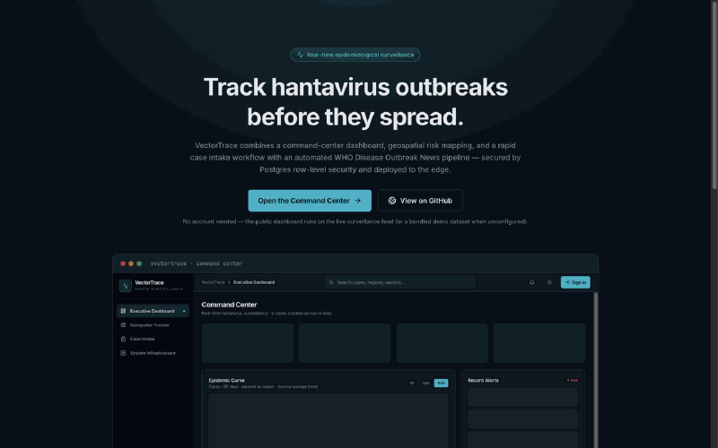
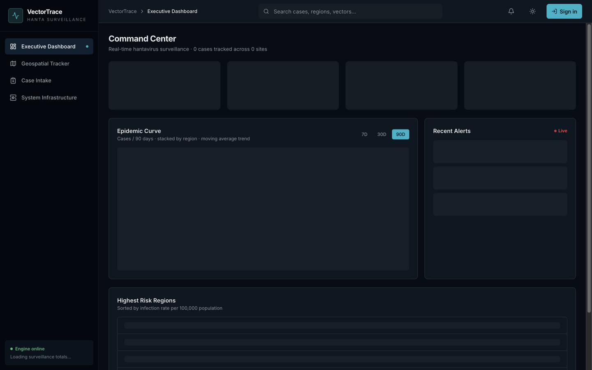
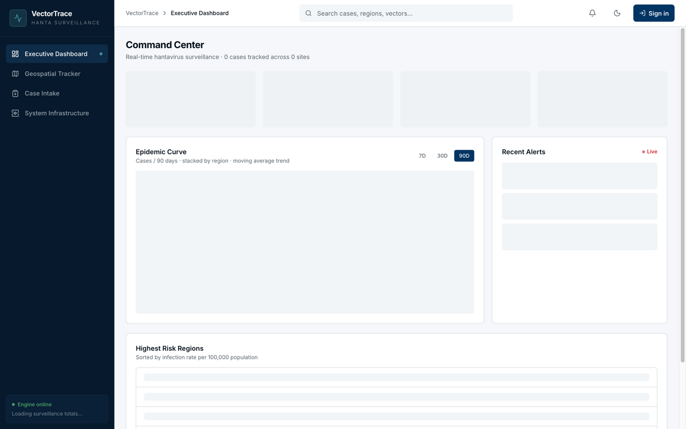
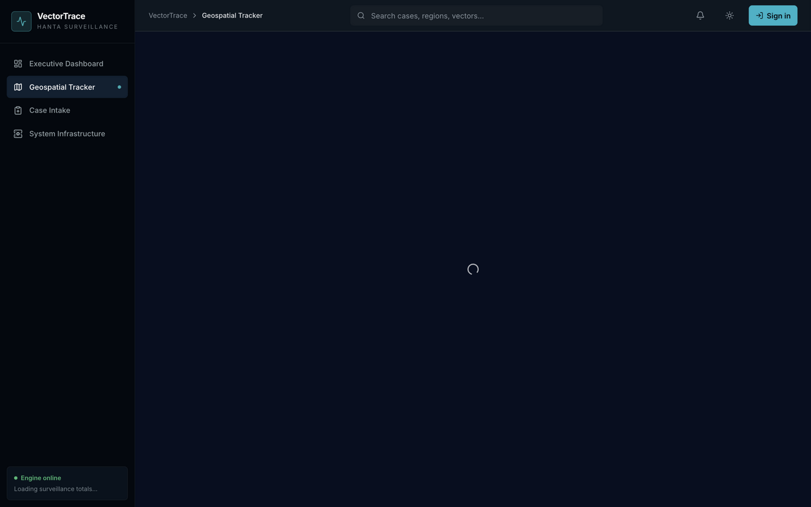

# VectorTrace — Hantavirus Surveillance Command Center

[](https://github.com/Sujaya-Nimneth/VectorTrace-Hantavirus-Surveillance/actions/workflows/deploy.yml)
[](LICENSE)
[](.nvmrc)
<!-- Update the href with your workers.dev account subdomain after the first deploy -->

[](https://vectortrace-hantavirus-surveillance.workers.dev)

**VectorTrace** is a real-time epidemiological surveillance platform for hantavirus. It combines a command-center dashboard, geospatial risk mapping, a role-gated rapid case intake workflow, and an automated WHO Disease Outbreak News ingestion pipeline — backed by Supabase (Postgres + RLS + Edge Functions) and deployed to Cloudflare Workers.

**A 15-second tour** — landing page → dashboard (light → dark) → geospatial tracker:



|                        Dashboard (dark)                        |                        Dashboard (light)                         |                  Geospatial tracker                  |
| :------------------------------------------------------------: | :--------------------------------------------------------------: | :--------------------------------------------------: |
|  |  |  |

## Highlights

- **Executive dashboard** — live case metrics with trend deltas, stacked epidemic curve (7/30/90-day windows), severity-filtered alerts feed, and a regional risk ranking with sorting, filtering, and CSV export.
- **Geospatial tracker** — Leaflet map with a keyless Esri dark basemap, case markers, rodent reservoir sites, a case-density heat layer with legend, and shareable focus URLs (`/map?case=…`).
- **Rapid case intake** — 4-step clinician workflow (demographics → clinical → exposure → review) with zod validation against controlled vocabularies, local drafts, and optimistic cache updates.
- **Role-based access** — Supabase Auth with `admin` / `epidemiologist` / `viewer` roles enforced by Postgres RLS (the UI gates are convenience; the database is the enforcement layer).
- **Automated ingestion** — a Supabase Edge Function scrapes WHO Disease Outbreak News via Firecrawl on a pg_cron schedule, normalizes and dedupes items, updates case statuses across runs, and raises alerts on confirmations.
- **Admin observability console** — ingest success rates, external feed uptime, DB latency percentiles, and pool telemetry, code-split out of the main bundle.
- **Demo mode** — with no credentials (or `VITE_DEMO_MODE=true`) the app serves a deterministic bundled dataset so the whole UI runs without a backend. Perfect for local dev and portfolio demos.
- **Dark mode** — system-aware, persisted, no theme flash.

## Architecture

```
                ┌──────────────────────────────────────────────┐
                │                Cloudflare Workers            │
                │  TanStack Start (React 19, SSR) + Vite       │
                │  ├── /            Executive dashboard        │
                │  ├── /map         Geospatial tracker (lazy)  │
                │  ├── /intake      Case intake (clinicians)   │
                │  └── /admin       Infra console (admin, lazy)│
                └───────────────┬──────────────────────────────┘
                                │ Supabase JS (public view / authed RLS)
                ┌───────────────▼──────────────────────────────┐
                │                  Supabase                    │
                │  Postgres + RLS ── hanta_cases (+ public      │
                │  projection), rodent_sites, hanta_alerts,    │
                │  user_roles, infra_* telemetry               │
                │  Realtime ── live INSERT push to the UI      │
                │                                              │
                │  Edge Functions (Deno)                       │
                │  ├── ingest-don-feed ── WHO DON via Firecrawl│
                │  └── infra-health-check ── uptime + DB probe │
                │        ▲ scheduled by pg_cron every 5 min /  │
                │          twice daily, fail-closed bearer auth│
                └──────────────────────────────────────────────┘
```

**Data minimization:** anonymous visitors read only the `hanta_cases_public` view — clinical columns (age, sex, symptoms, exposure narrative) are restricted to authenticated readers by RLS.

## Tech stack

| Layer         | Choices                                                                          |
| ------------- | -------------------------------------------------------------------------------- |
| UI            | React 19, TanStack Start + Router, Tailwind CSS 4, lucide-react, sonner          |
| Data          | TanStack Query v5, Supabase JS v2, Realtime channels, zod                        |
| Visualization | Recharts (epidemic curve, latency), Leaflet + leaflet.heat (map)                 |
| Backend       | Supabase Postgres with RLS, Edge Functions (Deno), pg_cron                       |
| Infra         | Cloudflare Workers (wrangler), Docker + Nginx (self-host parity), GitHub Actions |

## Quick start

```bash
npm install
npm run dev
```

That's it — without credentials the app boots in demo mode with a bundled dataset.

To connect a backend, create a `.env` from [`.env.example`](.env.example):

- `VITE_SUPABASE_URL`, `VITE_SUPABASE_PUBLISHABLE_KEY` — client
- `SUPABASE_URL`, `SUPABASE_SERVICE_ROLE_KEY` — server-only
- `FIRECRAWL_API_KEY`, `INGEST_TOKEN` — edge function secrets (`supabase secrets set`)
- `VITE_MAP_TILE_URL`, `VITE_MAP_TILE_ATTRIBUTION` — optional basemap provider override

### Quality gates

```bash
npm run lint          # eslint + prettier
npm run typecheck     # tsc --noEmit
npm run test          # vitest (unit)
npm run test:coverage # vitest + v8 coverage report
npm run build         # production build
```

## Supabase setup

The checked-in config targets project `wsgbrwmgiyecsbpvpfpd`. For a new or forked environment:

1. Authenticate and link the project:

   ```bash
   supabase login
   supabase link --project-ref <PROJECT_REF>
   ```

2. Apply the migrations in `supabase/migrations/` in order:

   ```bash
   supabase db push
   ```

3. Deploy the edge functions and set their secrets:

   ```bash
   supabase functions deploy ingest-don-feed
   supabase functions deploy infra-health-check
   supabase secrets set FIRECRAWL_API_KEY=<KEY> INGEST_TOKEN=<TOKEN>
   ```

4. Schedule them via the `infra_config` values created by the cron migration. Use the **same** token for `INGEST_TOKEN` and both scheduler rows:

   ```sql
   insert into public.infra_config (key, value)
   values
     ('supabase_functions_base_url', 'https://<PROJECT_REF>.supabase.co/functions/v1'),
     ('ingest_token', '<SAME_TOKEN_AS_INGEST_TOKEN_SECRET>'),
     ('healthcheck_token', '<SAME_TOKEN_AS_INGEST_TOKEN_SECRET>')
   on conflict (key) do update set value = excluded.value;
   ```

The edge functions fail closed: requests return `401` until `INGEST_TOKEN` is set and matches the `Authorization: Bearer ...` header. The cron jobs use the two `infra_config` token rows above.

The first user to sign up is auto-granted `admin`; everyone after gets `viewer`.

## Roles & security model

| Role               | Capabilities                                            |
| ------------------ | ------------------------------------------------------- |
| `admin`            | Everything + role management + infrastructure console   |
| `epidemiologist`   | Insert/update clinical cases and alerts                 |
| `viewer` (default) | Read surveillance data                                  |
| anonymous          | Public projection only (no clinical columns), no writes |

Security posture: RLS on every table with `WITH CHECK` clauses, check constraints on coordinates/age/positivity, constant-time bearer auth on edge functions (fail-closed without the token), query-cache wipe on sign-out, CSP + security headers in the Nginx config. See [SECURITY.md](SECURITY.md).

## Docker (optional self-host parity)

```bash
docker compose up --build          # web + nginx
docker compose --profile scheduler up   # opt-in Docker scheduler (pg_cron is the default)
```

## CI/CD

GitHub Actions runs lint, typecheck, tests with coverage, and a build on every PR, then deploys to **Cloudflare Workers** on pushes to `main` (wrangler pinned in devDependencies; deploy reuses the verified build artifact). Configure the repository secrets listed in `.env.example` plus `CLOUDFLARE_API_TOKEN` / `CLOUDFLARE_ACCOUNT_ID`.

## Roadmap

- Long-term SLA reporting and alerting for ingest failures
- Provider-specific health endpoints for uptime checks
- Marker clustering and seasonal-trend analytics on the map

## License

[MIT](LICENSE) © Sujaya Nimneth
