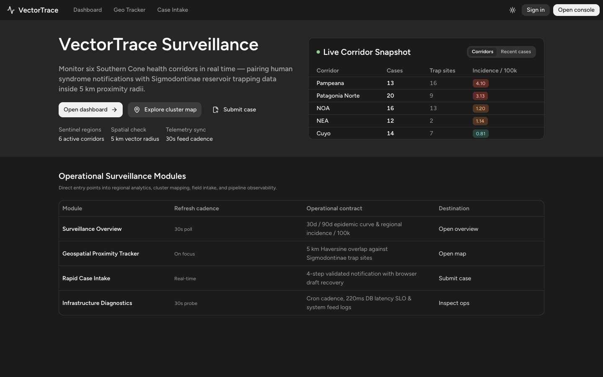
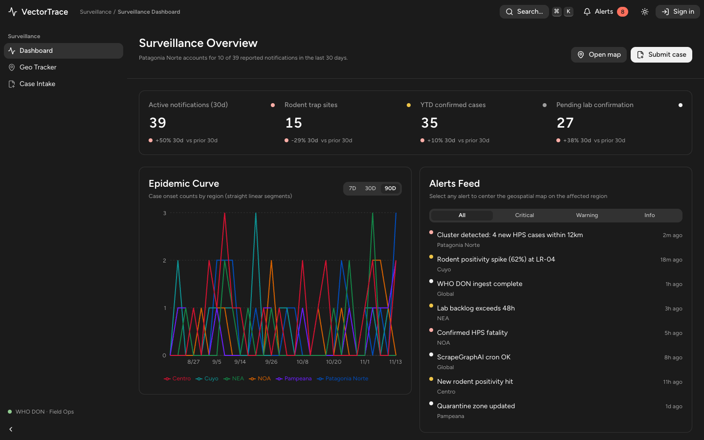
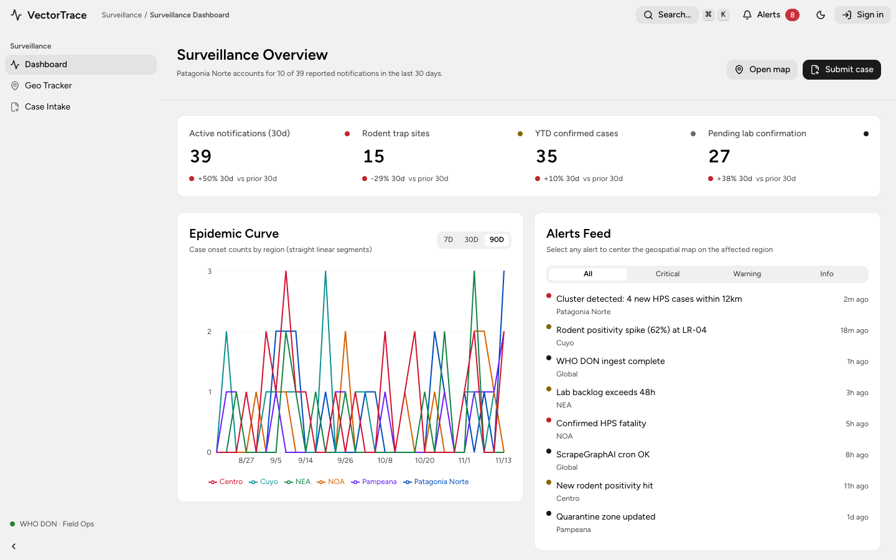
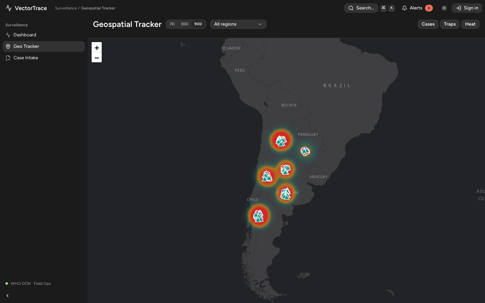
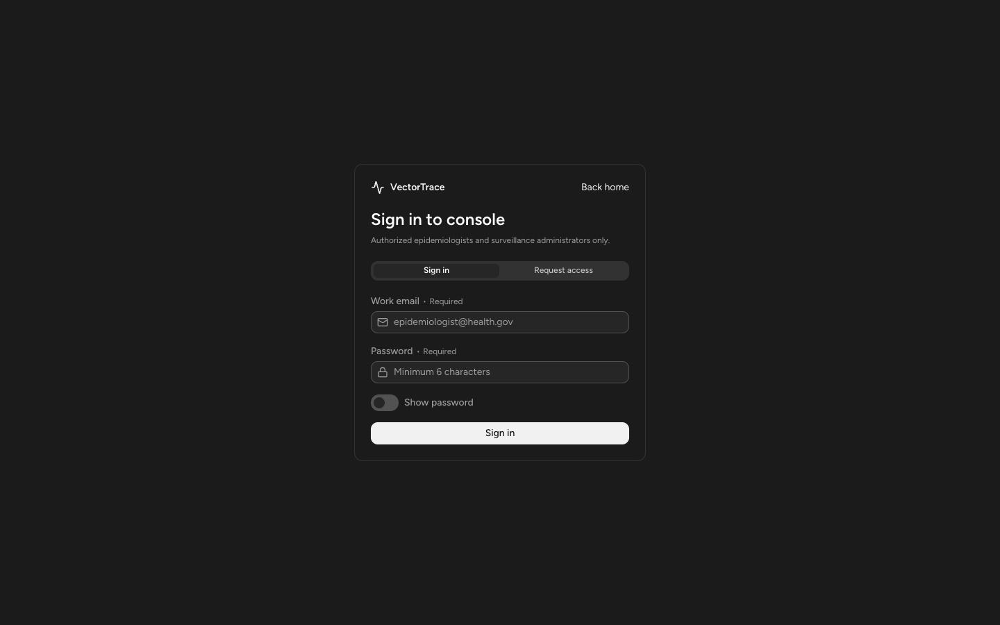

# VectorTrace — Multi-Disease Surveillance & Bio-Financial Outbreak Predictor

[](https://github.com/Sujaya-Nimneth/VectorTrace-Hantavirus-Surveillance/actions/workflows/deploy.yml)
[](LICENSE)
[](.nvmrc)
<!-- Update the href with your workers.dev account subdomain after the first deploy -->

[](https://vectortrace-hantavirus-surveillance.sujayanimneth.workers.dev)

**VectorTrace** is a real-time multi-pathogen epidemiological surveillance and bio-financial outbreak nowcasting platform. Expanding beyond its Southern Cone Hantavirus roots, VectorTrace tracks six high-consequence pathogens (**Hantavirus**, **Dengue**, **Avian Influenza H5N1**, **Mpox**, **Chikungunya / Zika**, and **Cholera**) and forecasts regional surges using market-neutral abnormal returns and trading-volume anomalies across disease-mapped pharmaceutical, diagnostic, vector-control, and hospital-consumable equities paired with syndromic Wikimedia velocity and climate suitability.

### Monitored Pathogens & Bio-Financial Baskets

| Pathogen                 | Code  | Sentinel Modality    | Radius   | Lead-Indicator Equities           |
| ------------------------ | ----- | -------------------- | -------- | --------------------------------- |
| **Hantavirus**           | `HTV` | Rodent traps         | `5 km`   | `GETI-B.ST`, `BAX`, `DHR`, `RTO`  |
| **Dengue Fever**         | `DNV` | Mosquito ovitraps    | `1.5 km` | `TAK`, `ABT`, `BAX`, `RTO`        |
| **Avian Influenza H5N1** | `H5N` | Avian sentinels      | `10 km`  | `CSL.AX`, `MRNA`, `RHHBY`, `QGEN` |
| **Mpox**                 | `MPX` | Wastewater nodes     | `5 km`   | `BAVA.CO`, `SIGA`, `DHR`, `EBS`   |
| **Chikungunya / Zika**   | `ARV` | Mosquito ovitraps    | `1.5 km` | `VALN`, `BIM.PA`, `ABT`, `RTO`    |
| **Cholera / Waterborne** | `CHL` | Water / sewage nodes | `3 km`   | `BAX`, `BIM.PA`, `BDX`, `ABT`     |

### Screenshots

|                      Public overview (dark)                       |                        Dashboard (dark)                        |
| :---------------------------------------------------------------: | :------------------------------------------------------------: |
|  |  |

|                        Dashboard (light)                         |                    Geospatial tracker                    |
| :--------------------------------------------------------------: | :------------------------------------------------------: |
|  |  |

|                      Operator sign-in                       |
| :---------------------------------------------------------: |
|  |

## Highlights

- **Public corridor & forecast snapshot** — `/` greets visitors with live corridor incidence metrics, multi-pathogen **Risk forecast** nowcasts (`Corridors` / `Risk forecast` / `Recent cases`), and module status contracts.
- **Bio-Financial Outbreak Predictor** — `/predictions` computes market-neutral cumulative abnormal returns (`CAR_i,t = r_i,t - [0.65·r_XBI,t + 0.35·r_SPY,t]`), institutional volume Z-scores, Wikimedia syndromic velocity, and Open-Meteo vector suitability — producing composite risk scores (`0–100`) and `+7d` to `+21d` lead-lag cross-correlations per disease basket.
- **Multi-pathogen dashboard** — `/dashboard` switches seamlessly across any single disease or aggregated all-pathogen mode via the top-bar pathogen selector, plotting multi-pathogen epidemic curves (`7D` / `30D` / `90D`), market-divergence early-warning banners, severity/source-tagged alerts, and sortable incidence tables (`/ 100k`) with CSV export.
- **Adaptive geospatial tracker** — `/map` plots human cases alongside 4 distinct sentinel site shapes (rodent traps, mosquito ovitraps, avian sentinels, wastewater nodes) and evaluates pathogen-specific Haversine proximity radii (`1.5 km`–`10 km`).
- **Global command palette & alerts** — `⌘K` / `Ctrl+K` quick jump across pages, pathogens, pharma tickers, corridors, cases, and sentinel sites alongside a live alerts popover and persisted light/dark mode.
- **Dynamic 4-step case intake** — `/intake` lets clinicians select the target pathogen, dynamically adapting syndromes (e.g., `HPS`/`HFRS`, `DENV-Classic`/`DENV-Severe`, `Clade-I`/`Clade-II`) and symptom checklists with zod validation and draft recovery.
- **Role-based access** — Supabase Auth with `admin` / `epidemiologist` / `viewer` roles enforced by Postgres RLS (UI route guards are convenience; Postgres RLS is the enforcement layer).
- **Automated multi-source ingestion** — Edge Functions scrape WHO Disease Outbreak News (`ingest-don-feed`) with a multi-pathogen classifier, fetch Yahoo Finance equity bars + Wikimedia pageviews + Open-Meteo climate signals (`ingest-market-signals`) on a `pg_cron` schedule, and raise divergence/confirmation alerts.
- **Admin observability console** — `/admin` monitors ingest telemetry, Yahoo Finance / Wikimedia / WHO probe uptimes, database latency against a `220ms` SLO threshold, and live feed logs.
- **Demo mode** — Without backend credentials (or with `VITE_DEMO_MODE=true`), the app generates deterministic multi-pathogen cases, sentinels, and 90-day equity bar fixtures across every view.

## Architecture

```
                ┌───────────────────────────────────────────────────────────┐
                │                    Cloudflare Workers                     │
                │  TanStack Start (React 19, SSR) + Astryx Design System    │
                │  ├── /            Public overview & risk snapshot         │
                │  ├── /dashboard   Multi-pathogen KPIs, curves & alerts    │
                │  ├── /predictions Bio-financial nowcasts & equity basket  │
                │  ├── /map         Geospatial clusters & adaptive radii    │
                │  ├── /intake      Dynamic 4-step clinical intake          │
                │  ├── /login       Operator authentication                 │
                │  └── /admin       Infra console (admin, lazy)             │
                └───────────────────────────┬───────────────────────────────┘
                                            │ Supabase JS (public view / authed RLS)
                ┌───────────────────────────▼───────────────────────────────┐
                │                          Supabase                         │
                │  Postgres + RLS ── diseases, hanta_cases (+ public view), │
                │  rodent_sites, hanta_alerts, pharma_tickers,              │
                │  disease_ticker_mappings, market_daily_bars,              │
                │  disease_nowcast_signals, user_roles, infra_*             │
                │  Realtime ── live INSERT push to UI                       │
                │                                                           │
                │  Edge Functions (Deno)                                    │
                │  ├── ingest-don-feed      ── Multi-pathogen WHO DON       │
                │  ├── ingest-market-signals── Yahoo Finance+Wiki+OpenMeteo │
                │  ├── infra-health-check   ── API uptime + DB latency      │
                │  └── geocode-case-locations ─ legacy coordinate repair    │
                │        ▲ scheduled by pg_cron; Vault-backed bearer auth   │
                └───────────────────────────────────────────────────────────┘
```

**Data minimization:** anonymous visitors read only the `hanta_cases_public` view — clinical columns (age, sex, symptoms, exposure narrative) are restricted to authenticated readers by RLS. Market bar and disease nowcast tables are publicly readable non-PII quantitative signals, with writes restricted to `service_role`.

## Tech stack

| Layer         | Choices                                                                                           |
| ------------- | ------------------------------------------------------------------------------------------------- |
| UI            | React 19, TypeScript, TanStack Start + Router, `@astryxdesign/core`, Tailwind CSS 4, lucide-react |
| Data          | TanStack Query v5, Supabase JS v2, Realtime channels, zod                                         |
| Visualization | Recharts (epidemic curves, nowcast trajectory, lead-lag correlogram, SLO), Leaflet + heat         |
| Backend       | Supabase Postgres with RLS, Edge Functions (Deno), pg_cron                                        |
| Signals       | Yahoo Finance daily OHLCV, Wikimedia Pageviews API, Open-Meteo weather, WHO DON (Firecrawl)       |
| Infra         | Cloudflare Workers (wrangler), Docker + Nginx (self-host parity), GitHub Actions                  |

## Quick start

```bash
npm install
npm run dev
```

That's it — without credentials the app boots in demo mode with a bundled dataset.

To connect a backend, create a `.env` from [`.env.example`](.env.example):

- `VITE_SUPABASE_URL`, `VITE_SUPABASE_PUBLISHABLE_KEY` — client
- `SUPABASE_URL`, `SUPABASE_PUBLISHABLE_KEY` — browser-safe Supabase client
- `FIRECRAWL_API_KEY` — Edge Function secret (`supabase secrets set`)
- `VITE_MAP_TILE_URL`, `VITE_MAP_TILE_ATTRIBUTION` — optional basemap provider override

### Quality gates

```bash
npm run lint          # eslint + prettier
npm run typecheck     # tsc --noEmit
npm run test          # vitest (unit)
npm run test:coverage # vitest + v8 coverage report
npm run build         # production build
```

## Supabase setup

The checked-in config targets project `wsgbrwmgiyecsbpvpfpd`. For a new or forked environment:

1. Authenticate and link the project:

   ```bash
   supabase login
   supabase link --project-ref <PROJECT_REF>
   ```

2. Apply the migrations in `supabase/migrations/` in order:

   ```bash
   supabase db push
   ```

3. Deploy the edge functions and set their secrets:

   ```bash
   supabase functions deploy ingest-don-feed
   supabase functions deploy ingest-market-signals
   supabase functions deploy infra-health-check
   supabase functions deploy geocode-case-locations
   supabase secrets set FIRECRAWL_API_KEY=<KEY>
   ```

4. Set the Functions base URL. The scheduler migration creates a random
   `scheduler_token` in Supabase Vault, stores only its SHA-256 digest in
   `infra_config`, and schedules both functions through a service-role-only
   helper:

   ```sql
   insert into public.infra_config (key, value)
   values ('supabase_functions_base_url', 'https://<PROJECT_REF>.supabase.co/functions/v1')
   on conflict (key) do update set value = excluded.value;
   ```

   Do not insert bearer tokens into `infra_config`. The Edge Functions fail
   closed and validate requests through the service-role-only
   `verify_function_token` RPC.

5. To repair legacy `0,0` coordinates, trigger the maintenance function from
   the SQL editor. The scheduler token is read directly from Vault and never
   printed or stored in repository files:

   ```sql
   select public.invoke_scheduled_function('geocode-case-locations');
   ```

Signups are disabled in the checked-in Auth config. Create users from the
Supabase dashboard; the first user is auto-granted `admin` and later users
default to `viewer`.

## Roles & security model

| Role               | Capabilities                                            |
| ------------------ | ------------------------------------------------------- |
| `admin`            | Everything + role management + infrastructure console   |
| `epidemiologist`   | Insert/update clinical cases and alerts                 |
| `viewer` (default) | Read surveillance data                                  |
| anonymous          | Public projection only (no clinical columns), no writes |

Security posture: RLS on every table with `WITH CHECK` clauses, check constraints on coordinates/age/positivity, Vault-backed scheduler credentials verified by a service-role-only RPC, query-cache wipe on sign-out, and CSP + HSTS security headers on Workers and Nginx. See [SECURITY.md](SECURITY.md).

## Docker (optional self-host parity)

```bash
docker compose up --build          # web + nginx
docker compose --profile scheduler up   # opt-in Docker scheduler (pg_cron is the default)
```

## CI/CD

GitHub Actions runs lint, typecheck, tests with coverage, and a build on every PR and push. **Cloudflare Workers Builds** owns production deployment from `main` with the deploy command `npx cf deploy`, so no Cloudflare credentials are stored in GitHub. Configure production environment variables in Cloudflare and optional build-time `VITE_*` values in GitHub.

## Roadmap

- Long-term SLA reporting and alerting for ingest failures
- Provider-specific health endpoints for uptime checks
- Marker clustering and seasonal-trend analytics on the map

## License

[MIT](LICENSE) © Sujaya Nimneth
